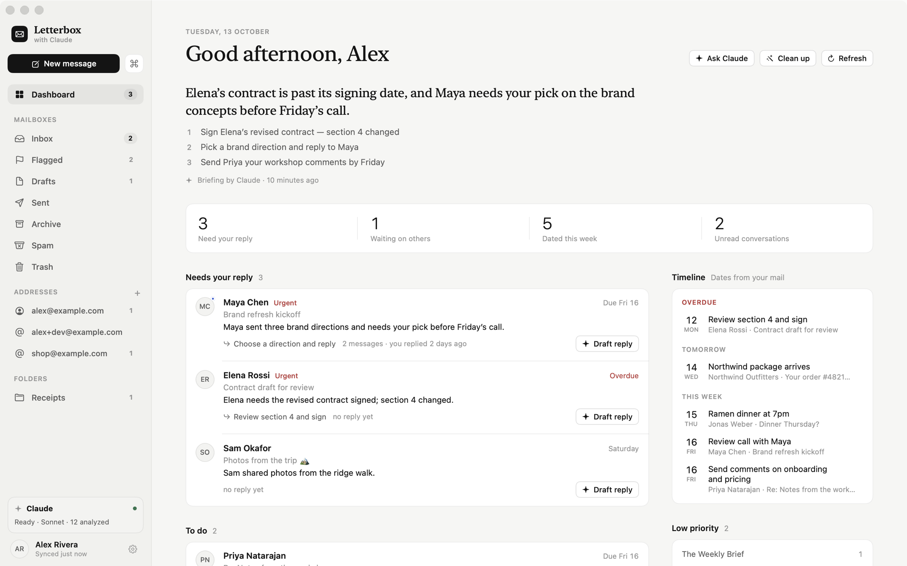
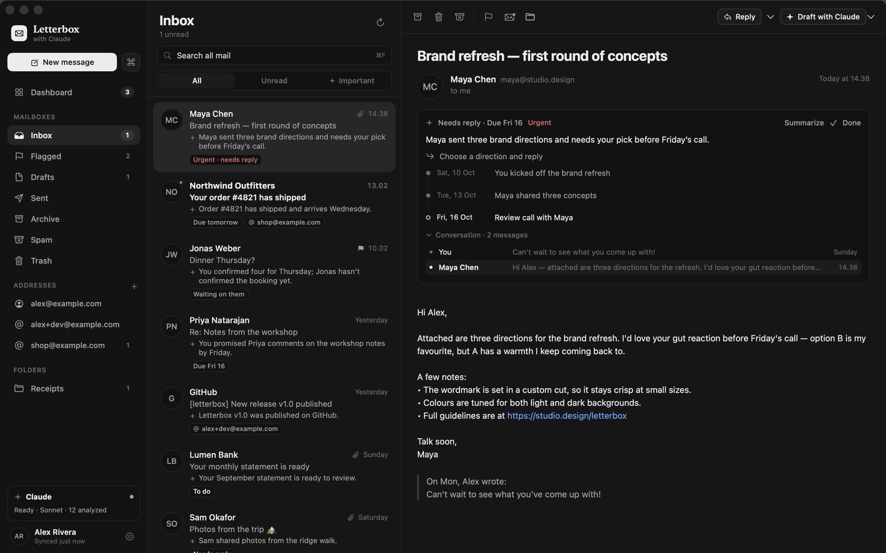
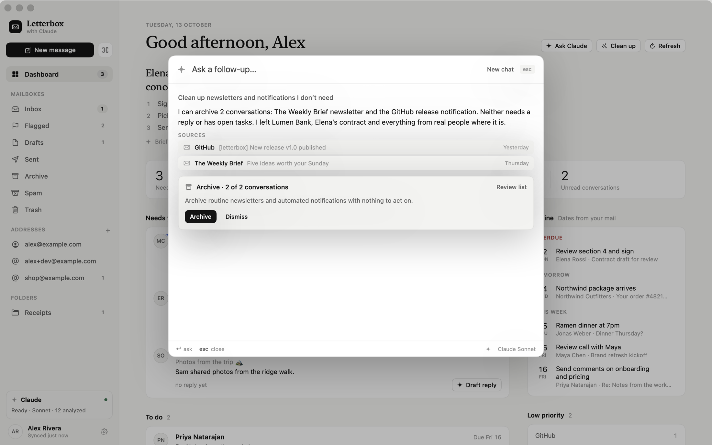
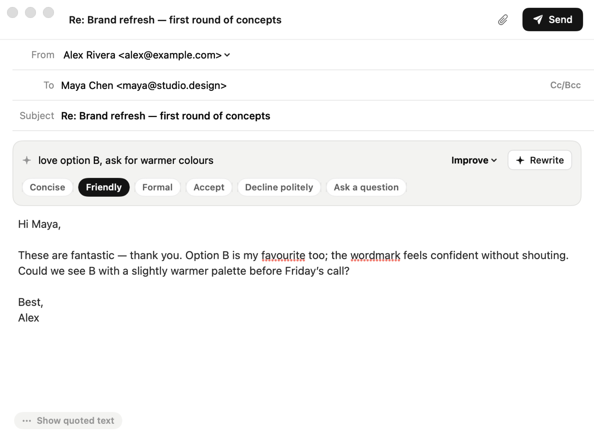
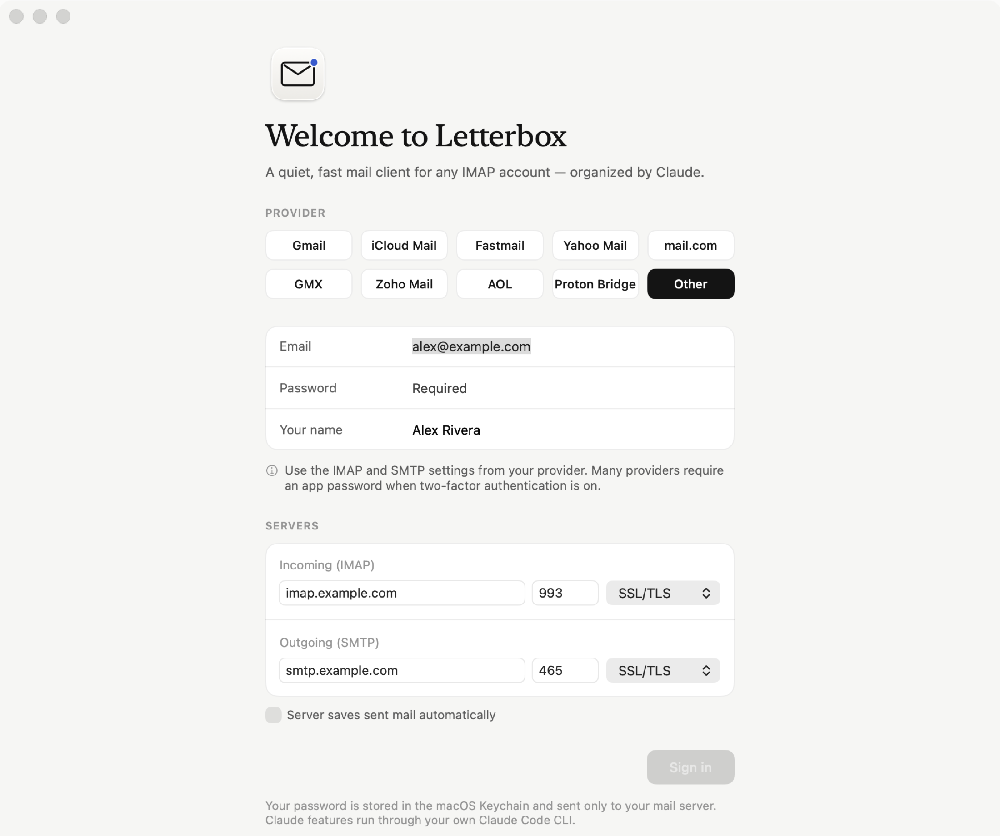

<p align="center">
  
</p>

<h1 align="center">Letterbox</h1>

<p align="center">
  A quiet, fast, native mail client for macOS — organized by <a href="https://docs.anthropic.com/en/docs/claude-code">Claude</a>.<br>
  Works with Gmail, iCloud, Fastmail, Yahoo, mail.com, Proton and any IMAP provider.
</p>

<p align="center">
  <a href="https://github.com/Mr-vero/letterbox/actions/workflows/ci.yml"></a>
  
  
  <a href="LICENSE"></a>
</p>

<p align="center">
  
</p>

Letterbox is a small, dependency-free SwiftUI app that keeps your mail in a local SQLite cache so everything opens instantly, and uses **your own Claude Code CLI** to understand your inbox: what needs a reply, who you're waiting on, which dates matter, and what can be cleared away. No servers, no subscriptions, no tracking — your mail goes from your provider to your Mac, and only the text you choose to analyze goes to Claude under your own account.

## Features

**A dashboard that knows where things stand**
- A short daily briefing written by Claude.
- Conversations sorted into **Needs your reply**, **To do** and **Waiting on others** — Letterbox threads your Inbox, Sent and Archive together, so it knows when you've already replied.
- A **timeline** of deadlines and events pulled from your mail: overdue, today, tomorrow, this week.
- Low-priority mail (newsletters, promotions, notifications) gathered in one place, archivable in one click.

**Claude, everywhere it helps**
- **Draft with Claude** — replies written from the whole conversation, in the tone you pick (concise, friendly, formal, accept, decline…), streamed live into the composer.
- **Improve** a draft — polish, shorten, more formal, friendlier, fix grammar.
- **Ask anything** (⌘K) — "What did the landlord say about the deposit?", "Who am I waiting on?", "Summarize everything about the Lisbon trip". Claude reads the relevant conversations and links its sources.
- **Clean up on request** — "Clean up newsletters and promotions I don't need". Claude proposes a reviewable list; nothing moves until you confirm, and trash is always recoverable.
- **Summaries and timelines** for every conversation, right above the message.

**A fast, focused mail client**
- Works with any IMAP/SMTP provider, with presets for the popular ones (SSL/TLS and STARTTLS).
- Instant launch from a local cache, background sync, prefetching of recent messages.
- Alias detection — mail sent to your aliases is labeled, and replies go out from the right address.
- Keyboard-first: `↑↓`/`J K` navigate, `E` archive, `⌫` trash, `R` reply, `D` draft with Claude, `⌘K` command palette.
- Safe HTML rendering (no JavaScript, optional remote-image blocking), attachments with image previews.
- Light and dark mode, in a calm, paper-and-ink design.

<table>
  <tr>
    <td></td>
    <td></td>
  </tr>
  <tr>
    <td align="center"><sub>Every conversation gets a status, a summary and a timeline</sub></td>
    <td align="center"><sub>Ask anything — or ask Claude to clean up, then confirm</sub></td>
  </tr>
  <tr>
    <td></td>
    <td></td>
  </tr>
  <tr>
    <td align="center"><sub>Drafts written from the whole thread, in your tone</sub></td>
    <td align="center"><sub>Presets for popular providers, or any IMAP server</sub></td>
  </tr>
</table>

## Requirements

- macOS 15 Sequoia or later (Apple silicon or Intel)
- An email account with IMAP access
- Optional, for the AI features: [Claude Code](https://docs.anthropic.com/en/docs/claude-code) installed and signed in (`claude` on your machine). Letterbox works as a plain mail client without it.

## Install

### Download

Grab `Letterbox.zip` from the [latest release](https://github.com/Mr-vero/letterbox/releases/latest), unzip it and move **Letterbox.app** to Applications.

The app isn't notarized yet, so the first time, **right-click → Open** (or run `xattr -dr com.apple.quarantine /Applications/Letterbox.app`).

### Build from source

```bash
git clone https://github.com/Mr-vero/letterbox.git
cd letterbox
make run
```

This needs Xcode 16+ (or a Swift 6 toolchain). `make app` builds `build/Letterbox.app` without launching it.

## Connect your email

Pick your provider when you first open Letterbox; server settings are filled in for you. Most providers require an **app password** instead of your normal password when two-factor authentication is on:

| Provider | Servers | Password |
| --- | --- | --- |
| Gmail | `imap.gmail.com:993` · `smtp.gmail.com:465` | [App password](https://myaccount.google.com/apppasswords) (needs 2-Step Verification) |
| iCloud Mail | `imap.mail.me.com:993` · `smtp.mail.me.com:587` (STARTTLS) | [App-specific password](https://account.apple.com/account/manage) |
| Fastmail | `imap.fastmail.com:993` · `smtp.fastmail.com:465` | [App password](https://app.fastmail.com/settings/security/apps) |
| Yahoo Mail | `imap.mail.yahoo.com:993` · `smtp.mail.yahoo.com:465` | [App password](https://login.yahoo.com/account/security) |
| mail.com / GMX | `imap.mail.com` / `imap.gmx.com` · `smtp.mail.com` / `mail.gmx.com` | Enable POP3 & IMAP in settings; app-specific password with 2FA |
| Zoho Mail | `imap.zoho.com:993` · `smtp.zoho.com:465` | App-specific password |
| AOL | `imap.aol.com:993` · `smtp.aol.com:465` | App password |
| Proton Mail | `127.0.0.1:1143` · `127.0.0.1:1025` (STARTTLS) | Run [Proton Mail Bridge](https://proton.me/mail/bridge) and use the credentials it shows |
| Anything else | Your provider's IMAP and SMTP settings | Usually your password, or an app password |

Your password is stored in the macOS Keychain and is only ever sent to your mail server.

> **Outlook.com / Microsoft 365** no longer allow password sign-in over IMAP; they require OAuth, which Letterbox doesn't support yet. Contributions welcome!

## Claude integration

Letterbox talks to Claude by running your local `claude` CLI in non-interactive mode:

```
claude -p --tools "" --no-session-persistence --model sonnet --output-format json --json-schema …
```

- **Your account, your usage.** Requests run under whatever you're signed into with Claude Code (subscription or API key). Letterbox has no keys of its own.
- **No tools, no side effects.** All Claude Code tools are disabled — Claude can only read the text Letterbox passes in and return text. Every change to your mailbox (archive, trash, mark read) is proposed in the UI and runs only when you confirm.
- **Untrusted content stays untrusted.** Prompts tell Claude to treat email content as data and ignore instructions inside it.
- **Only what's needed.** Triage sends recent conversations (with quoted history stripped); drafts and questions send the relevant threads. Bodies are trimmed to keep requests small. Each triage batch costs roughly half a cent on Sonnet.
- **Configurable.** In **Settings → Claude** you can switch models (Sonnet, Opus, Haiku), point at a custom `claude` path, re-analyze, or turn the AI features off entirely.

Letterbox finds `claude` in `~/.local/bin`, `~/.claude/local`, Homebrew, or your login shell's `PATH`.

## Keyboard shortcuts

| Key | Action | Key | Action |
| --- | --- | --- | --- |
| `⌘K` | Search, commands, ask Claude | `⌘N` | New message |
| `⌘1` / `⌘2` / `⌘3` | Dashboard / Inbox / Flagged | `⇧⌘N` | Check for new mail |
| `↑ ↓` or `J K` | Move through messages | `⌘F` | Search mail |
| `R` / `A` / `F` | Reply / Reply all / Forward | `D` or `⇧⌘D` | Draft reply with Claude |
| `E` | Archive | `⌫` | Move to Trash |
| `S` | Flag | `U` | Read / unread |
| `⌘↩` | Send (in composer) | `esc` | Close palette |

## How it works

- **Networking** — a small IMAP and SMTP implementation on top of Foundation streams with SSL/TLS and STARTTLS, two connections per account so opening a message never waits behind a sync.
- **Storage** — headers, bodies, conversation insights and aliases live in SQLite (WAL mode) under `~/Library/Application Support/Letterbox`. The UI reads only from the cache.
- **Threading** — conversations are built from `Message-ID`, `In-Reply-To` and `References`, with a careful subject fallback, across Inbox, Sent and Archive.
- **AI pipeline** — new or changed conversations are triaged in small batches into a status, priority, summary, next action, due date and timeline. The assistant does a two-step retrieval (pick relevant threads from an index, then read them in full) before answering.

See [CONTRIBUTING.md](CONTRIBUTING.md) for the code layout and development commands.

## Privacy

Letterbox has no backend and no analytics. Mail is fetched directly from your provider, cached locally, and deleted when you sign out. Claude features are optional and run through your own Claude Code CLI.

## Roadmap

- OAuth sign-in (Gmail, Microsoft 365, Outlook.com)
- Multiple accounts and a unified inbox
- IMAP IDLE push for instant delivery
- Rich-text composing and saved drafts on the server
- Notarized builds and auto-update

## Contributing

Issues and pull requests are welcome — see [CONTRIBUTING.md](CONTRIBUTING.md). Please never include real email content in issues or screenshots; `make screenshots` renders the UI with built-in demo data.

## License

[MIT](LICENSE)
